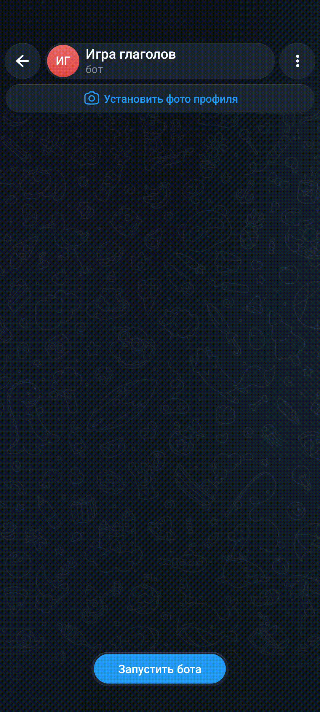
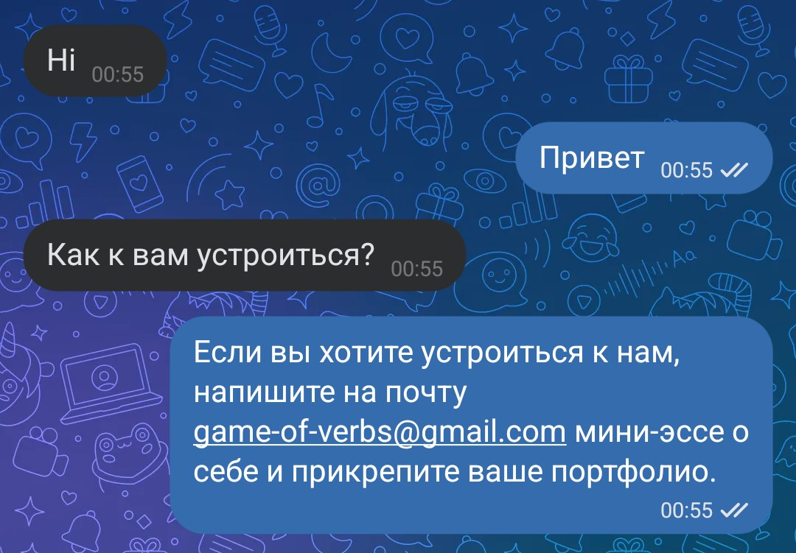

# AI бот
Telegram и ВК бот, который принимает сообщения пользователя и отвечает на них через Google DialogFlow.

## Установка
В папке проекта создайте .env файл со следующими переменными окружения:
```
TG_TOKEN=your-tg-bot-token
DIALOGFLOW_PROJECT_ID=your-dialogflow-project-id
VK_TOKEN=your-vk-chat-token
LOGS_TG_CHAT_ID=admin-tg-chat-id
```
- TG_TOKEN - токен Телеграм бота
- DIALOGFLOW_PROJECT_ID - ID проекта DialogFlow
- VK_TOKEN - API ключ сообщества Вконтакте
- LOGS_TG_CHAT_ID - Telegram chat id, куда приходят логи ТГ-бота

Python3 уже должен быть установлен. Установка зависимостей:
```
pip install -r requirements.txt
```

Создайте проект в [DialogFlow](https://dialogflow.cloud.google.com/#/login) и получите идентификатор проекта. Добавьте Intent и натренируйте на Training phrases и Responses.

### Telegram бот
- Создайте Telegram бот, используя [BotFather](https://telegram.me/BotFather), и получите API токен бота.
- Получите chat id админа в Telegram для получения логов, используя [userinfobot](https://t.me/userinfobot).

Запустите скрипт из командной строки:
```
python tg_bot.py
```

Пример бота в Телеграм - [@verbplay_dvmn_bot](https://t.me/verbplay_dvmn_bot)



### ВК бот
Создайте сообщество во Вконтакте и получите API ключ сообщества.
Запустите скрипт из командной строки:
```
python vk_bot.py
```

Пример бота в ВК - https://vk.ru/club242101970



### Обучение DialogFlow по API
В папке проекта создайте JSON-файл c возможными вопросами и ожидаемыми ответами для обучения DialogFlow. Пример данных:
```
{
    "Устройство на работу": {
        "questions": [
            "Как устроиться к вам на работу?",
            "Как устроиться к вам?",
            "Как работать у вас?",
            "Хочу работать у вас",
            "Возможно-ли устроиться к вам?",
            "Можно-ли мне поработать у вас?",
            "Хочу работать редактором у вас"
        ],
        "answer": "Если вы хотите устроиться к нам, напишите на почту game-of-verbs@gmail.com мини-эссе о себе и прикрепите ваше портфолио."
    }
}
```

Запустите скрипт для обучения DialogFlow `create_intents.py` из командной строки. В качестве аргумента укажите путь к JSON-файлу с интентами.
```
python create_intents.py intents.json
```
Проверьте в проекте DialogFlow, что интент был успешно создан.
